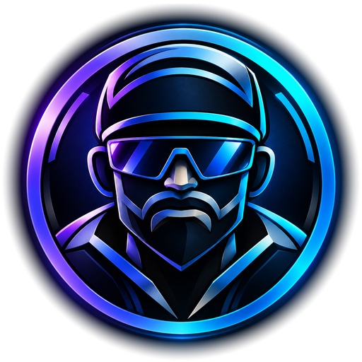

# ShadowAI — a distributed, local-first AI organism

ShadowAI is one "organism" spread across several computers on a home network. It builds its own tools ("hands") through a *forge*
where teacher and student models write code and tests, routes work with a *decision triangle* (present × future × past transport
cost), gates actions with a fast/slow judgement engine (*JEV*, System 1 / System 2) and keeps memory in a multi-quadrant RAG.
This repository is a curated, sanitized excerpt of the private monorepo — an architecture showcase, not a runnable product.

Polish version: [README.md](README.md)

## Vision

> "Energy-efficient training, an external database with local models as touch points and redirection of the shot —
> training without training, a distributed organism." — the operator, 2026-11-08
>
> Goal: AGI measured with the same yardsticks as frontier labs' models, with speed coming from architecture (escalation, routing,
> the forge) rather than from the size of a single model.

## What Shadow is

Every node has a role, and the organism decides where to compute what:

| Node role | What it does |
|---|---|
| Core | backend (FastAPI), loop scheduler, database, forge, inference |
| Heavy Brain | large reasoning models (Linux, unified memory) |
| Senses | the operator's PC: screen, input, games, UI |
| Render ×2 | Wan 2.2, ComfyUI, NVENC, video editing |
| Encode | encoding, radio, phone line |

The organism consists of **hands** (modules that do work: publishing, mail, invoices, phone, smart home, music videos, games),
**loops** (75 scheduler ticks), **memory** (quadrant RAG, lessons, learning layer) and **decision organs**.

## Key ideas (code in `src/`)

- **The forge — Shadow writes its own hands** (`src/kuznia/reka_kuznia.py`). The operator says in one sentence what they want; the
  forge builds a contract, cuts the needed context out of the repo, a teacher model writes the hand or patch + tests, a judge runs the
  tests, a reviewer from a different model family checks them, and a human (or a Claude review) wires the result in.
  Example: `src/organizm/odbior_2_hand.py` was written entirely by the forge.
- **Decision triangle — transport in time** (`src/trojkat/node_hardware_truth.py`, `docs/rownanie_przenoszenia_w_czasie.md`).
  Cost of moving a task to a node = PRESENT (free memory, temperature, load) × FUTURE (who will need the machine — humans first) ×
  PAST (trajectory of earlier outcomes). Absorbing state (CTL) and return.
- **JEV — fast and slow judgement** (`src/jev/`). A small model gives a quick verdict with confidence (System 1); at low confidence
  System 2 decides; results feed back as calibration.
- **Model router across nodes** (`src/router/ollama_router.py`). A model goes where it really fits; fallback on failure, per-node
  rules (e.g. the conversation node keeps only a small model), time budgets.
- **Conversation memory and tensions** (`src/pamiec/`, `src/organizm/tension_engine.py`, `src/rag/`). Layered operator memory with
  corrections and freshness; tensions detect contradictory answers but block only actions, never the operator's command.
- **Self-audit and scouting** (`src/organizm/`). Probes of services, listeners, backups, loops and channels; before saying "it
  doesn't exist", Shadow searches itself and the machines on the network.
- **Storage** (`src/magazyn/`). Recordings move to three disks chosen by the triangle; the original is deleted only after a
  matching SHA-256 of the copy; a game guard — nothing is copied while someone is playing.
- **Music videos — artistic flow** (`src/teledysk/`, `docs/ZASADY_ARTISTIC_FLOW.md`). Inspirations → idea → scenes in batches →
  director's plan (author + critic, cut "hits" on the lyrics' words) → frames with vision checks → Wan motion on several nodes.
- **Shorts and MACHINE EYE** (`src/shorty/`). PL/EN shorts from game clips with titles from frames (vision model); a series where the
  machine predicts what happens in a clip and a scoreboard counts EYE vs. player.
- **Merch** (`src/merch/`). Print-on-demand factory: slogan → print files → platform listings (behind an operator gate).

## Honestly: what is still missing

- One live organ registry — organs know each other only partly (the registry reports 1 of ~231 organs; lists are manual).
- The triangle's PAST term learns from a small part of the trajectory; energy (W, PV, tariff) is not yet part of the cost.
- Some loops write signals nobody reads; a "failure → forge order" bridge is being built.
- Hands often know only one source (one machine, one format) — fixed case by case through the forge; a standing direction of work.

## Privacy and security

Built with `zbuduj_pakiet.py`: copies selected files from the private repo and removes private data (names, clients, numbers,
e-mail addresses, secrets, home paths; LAN addresses masked as 10.0.0.x). Scan after cleaning: `SKAN.md`.
No `.env`, databases, client or family data.

## Status and license

Architecture excerpt — modules depend on the private backend and will not run on their own.
License: **Apache 2.0** (`LICENSE`). The ShadowAI name and visual identity are not covered by the license (`NOTICE`).
