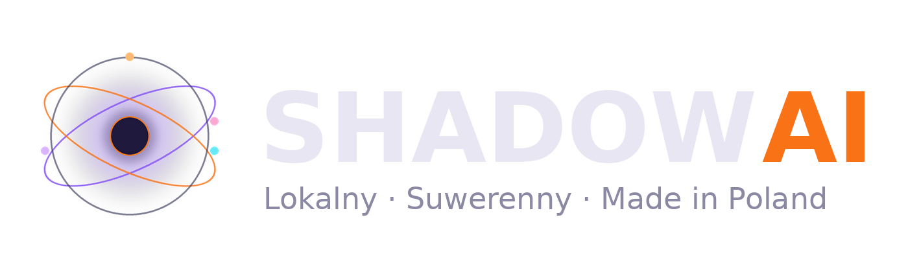

# ShadowAI — rozproszony organizm AI (local-first)

> **EN:** ShadowAI is a local-first, distributed "AI organism" running on a home LAN of six machines. It builds its own tools
> ("hands") through a *forge* where teacher and student models write code and tests, routes work with a *decision triangle*
> (present × future × past transport cost), gates actions with a fast/slow judgement engine (*JEV*, System 1 / System 2) and keeps
> memory in a multi-quadrant RAG. This repository is a curated, sanitized excerpt of the private monorepo — not a runnable product.

## Wizja

> „Energooszczędne trenowanie, zewnętrzna baza danych z lokalnymi modelami jako punkty styku i przekierowanie strzału — trenowanie bez treningu, rozproszony organizm.” — operator, 08.11.2026
>
> Cel: AGI mierzone tymi samymi miarami co modele największych laboratoriów, ale z szybkością wynikającą z architektury (eskalacja, routing, kuźnia), a nie z wielkości jednego modelu.

English version: [README.en.md](README.en.md)

## Czym jest Shadow

Shadow to jeden organizm rozłożony na kilka komputerów w domowej sieci. Każdy węzeł ma rolę, a organizm sam decyduje, gdzie co policzyć:

| Rola węzła | Co robi |
|---|---|
| Core | backend (FastAPI), harmonogram pętli, baza, kuźnia, inference |
| Heavy Brain | duże modele do rozumowania (Linux, pamięć zunifikowana) |
| Senses | komputer operatora: ekran, wejście, gry, interfejs |
| Render ×2 | Wan 2.2, ComfyUI, NVENC, montaż wideo |
| Encode | kodowanie, radio, tor telefonu |

Organizm składa się z **rąk** (moduły wykonujące zadania: publikacje, mail, faktury, telefon, smarthome, teledyski, gry),
**pętli** (75 ticków harmonogramu), **pamięci** (RAG w kwadrantach, lekcje, warstwa learning) i **narządów decyzji**.

## Kluczowe idee (kod w `src/`)

- **Kuźnia — Shadow pisze własne ręce** (`src/kuznia/reka_kuznia.py`). Operator mówi zdaniem, czego chce; kuźnia buduje kontrakt,
  wycina z repo potrzebny kontekst, nauczyciel (duży model) pisze rękę albo poprawkę + testy, sędzia uruchamia testy, a człowiek
  (albo przegląd Claude) wpina wyrób. 7 dni: 159 zamówień → 108 wpiętych.
- **Trójkąt decyzyjny — przenoszenie w czasie** (`src/trojkat/node_hardware_truth.py`, `docs/rownanie_przenoszenia_w_czasie.md`).
  Koszt przeniesienia zadania na węzeł = TERAŹNIEJSZOŚĆ (wolna pamięć, temperatura, obciążenie) × PRZYSZŁOŚĆ (kto będzie potrzebował
  maszyny — człowiek ma pierwszeństwo) × PRZESZŁOŚĆ (trajektoria wcześniejszych skutków). Stan pochłaniający (CTL) i powrót.
- **JEV — sąd szybki i wolny** (`src/jev/`). Mały model daje szybki osąd z pewnością (System 1); przy niskiej pewności decyduje
  System 2; wyniki wracają jako kalibracja.
- **Multi-RAG w kwadrantach** (`src/rag/quadrant_config.py`). Osobne kwadranty wiedzy (tech, mentor, firma, kreacja, operacje,
  rodzina), embeddingi na CPU.
- **Samoaudyt organizmu** (`src/organizm/organism_probes.py`). Sondy usług, nasłuchów, kopii, pętli i kanałów; usterki z ważnością,
  napięcia i remedia.

- **Router modeli po węzłach** (`src/router/ollama_router.py`). Model idzie tam, gdzie ma realnie miejsce; zapas przy awarii,
  reguły węzłów (np. węzeł rozmowy trzyma tylko mały model), budżet czasu.
- **Pamięć rozmowy i napięcia** (`src/pamiec/operator_memory.py`, `src/organizm/tension_engine.py`, `src/rag/rag_service.py`).
  Warstwy pamięci operatora z korektami i świeżością; napięcia wykrywają sprzeczne odpowiedzi, ale blokują tylko akcję, nie polecenie.
- **Zwiad organizmu** (`src/organizm/zwiad_organizmu_hand.py`, `zwiad_wezlow_hand.py`). Zanim Shadow powie „nie ma”, szuka w sobie
  i na maszynach sieci; `odbior_2_hand.py` to ręka napisana w całości przez kuźnię (produkt na dysk operatora + dowód co do bajta).
- **Magazyny i nagrania** (`src/magazyn/`). Nagrania z maszyn trafiają na trzy dyski wybierane trójkątem; oryginał znika dopiero po
  zgodnym SHA256 kopii; straż gry — nic nie kopiuje, gdy ktoś gra.
- **Teledyski — artistic flow** (`src/teledysk/`, `docs/ZASADY_ARTISTIC_FLOW.md`). Inspiracje → pomysł → sceny partiami → plan
  reżyserski (autor + krytyk, „stuki” cięć na słowach tekstu) → kadry z kontrolą wizji → ruch Wan na kilku węzłach.
- **Shorty i OKO MASZYNY** (`src/shorty/`). Shorty PL/EN z klipów gry z tytułami z klatek (model wizji); seria, w której maszyna
  typuje, co stanie się w klipie, a tablica liczy OKO kontra gracz.
- **Merch** (`src/merch/`). Fabryka print-on-demand: hasło → pliki do druku → oferty na platformy (z bramką operatora).

## Uczciwie: czego jeszcze brakuje (audyt 05.11.2026, aktualizacja 09.11)

- Jeden żywy rejestr organów — dziś organy znają siebie częściowo (rejestr melduje 1 z ~231 organów, listy są ręczne).
- Człon PRZESZŁOŚCI trójkąta uczy się z małej części trajektorii, a energia (W, PV, taryfa) nie wchodzi jeszcze do kosztu.
- Część pętli pisze sygnały, których nikt nie czyta (decyzje debat, zadania debug) — w budowie most „porażka → zamówienie w kuźni”.
- Ręce często znają tylko jedno źródło (jedną maszynę, jeden format) — 08–09.11 kuźnia poprawiła m.in. shorty (32:9, tytuły z
  obrazu), nagrania (katalogi NVIDIA z pomiaru) i kierowanie zdań w rozmowie; to stały kierunek prac.

## Prywatność i bezpieczeństwo

Pakiet budowany skryptem `zbuduj_pakiet.py`: kopiuje wybrane pliki z prywatnego repo i usuwa dane prywatne (imiona, klienci, numery,
adresy e-mail, sekrety, ścieżki domowe; adresy LAN zamaskowane jako 10.0.0.x). Wynik skanu po czyszczeniu: `SKAN.md`.
Brak `.env`, baz, danych klientów i rodziny.

## Status i licencja

Wyciąg do pokazania architektury — moduły zależą od prywatnego backendu i nie uruchomią się samodzielnie.
Licencja: **Apache 2.0** (`LICENSE`). Nazwa i identyfikacja wizualna ShadowAI nie są objęte licencją (`NOTICE`).
